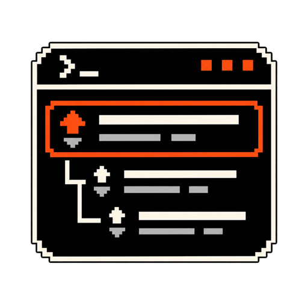

# ReddTTY

<p align="center">
  
</p>

[](https://www.rust-lang.org)
[](LICENSE)
[](https://github.com/TalhaAksoy/reddtty/actions/workflows/build.yml)
[](https://github.com/TalhaAksoy/reddtty/releases/latest)

A fast, keyboard-first Reddit reader for the terminal, written in Rust with
[Ratatui](https://ratatui.rs). ReddTTY is **local-first**: bookmarks, read state
and filters stay on your machine, and source changes never require a restart.

> Not affiliated with Reddit. “ReddTTY” is a working name.

## Highlights

### Reading

- Feed, post detail, recursive comments, gallery and full-screen image viewer
- Image viewer with zoom/pan, thumbnail strip and next-image preloading
- Content-sized post detail with a community/about panel on wide terminals
- `i` community-info drawer on narrow terminals
- Comment navigation: root/parent jumps, collapse all, OP-only, next unread
- Cursor pagination, search, sort menus and Top time ranges
- Mouse support and responsive three-pane layout

### Local-first library

- Local bookmarks with an offline post snapshot
- Read/unread state for posts and comments
- Local filters: hide read, keywords, subreddits, authors and domains
- Quick mute (`M`/`A`/`D`) with `u` undo for subreddit/author/domain
- Bookmarks, read state and filters live in `library.toml` next to the config;
  concurrent sessions merge bookmark/read/filter deltas under an OS file lock
- No Reddit write actions: saving, reading and filtering are client-side only

### Sources and reliability

- Offline demo data, Reddit OAuth, Old Reddit HTML and Redlib HTML
- Instant, restart-free provider/config switching
- Source health screen: host, status, latency, errors, retry and manual switching
- Clear errors when a source blocks a listing; no automatic instance rotation,
  CAPTCHA bypass, cookie extraction or scraping tricks

### Interface

- Command palette (`:` or `Ctrl+P`) with text aliases and recent actions
- Dark, light, Catppuccin, high-contrast and monochrome themes
- `--no-color` / `NO_COLOR`, reduced motion and a categorized searchable help screen
- Context-aware keyboard hints, breadcrumbs and a scrollable/searchable help screen
- Last feed and sort restored on the next launch
- Kitty, iTerm2, Sixel and Unicode half-block image rendering
- No telemetry or credential logging

## Install

### Prebuilt release

Download the archive for your platform from
[GitHub Releases](https://github.com/TalhaAksoy/reddtty/releases/latest):

```text
reddtty-linux-x86_64.tar.gz
reddtty-darwin-arm64.tar.gz
```

Each archive ships with a matching `.sha256` file and contains the `reddtty`
binary, README, LICENSE and example configs.

```bash
# Optional: verify the checksum
shasum -a 256 -c reddtty-darwin-arm64.tar.gz.sha256   # macOS
sha256sum -c reddtty-linux-x86_64.tar.gz.sha256       # Linux

tar -xzf reddtty-linux-x86_64.tar.gz
sudo install -m 0755 reddtty /usr/local/bin/reddtty
```

The macOS release is built for Apple Silicon (ARM64). It is unsigned; if
Gatekeeper quarantines it, remove the attribute from the extracted binary:

```bash
xattr -d com.apple.quarantine ./reddtty
```

### Build from source

```bash
git clone https://github.com/TalhaAksoy/reddtty.git
cd reddtty
cargo build --release
./target/release/reddtty --demo
```

Install the binary:

```bash
cargo install --path .
```

or:

```bash
make install        # /usr/local/bin/reddtty
```

## Quick start

```bash
# Fully offline demo
reddtty --demo

# First run with no config opens an interactive config picker
reddtty

# Choose a source directly (explicit network consent)
reddtty --provider redlib --redlib-instance https://redlib.example --allow-network

# Start on a subreddit or sort
reddtty --subreddit rust --sort new

# Show environment/provider/image diagnostics
reddtty --diagnostics
```

On first launch, ReddTTY installs a starter config from
[`configs/`](configs/) or accepts a custom HTTPS Redlib root URL. The same picker
is available later from **Settings** (`S`). Custom instances require an explicit
network-consent confirmation and are tested before they replace the active
source. Changing the provider first tests the candidate with a bounded request,
then applies it. Cancelling or closing the picker drops the candidate result.
If the configuration cannot be backed up or saved, the previous source remains
active. A failed test keeps the previous source and configuration.
Favorites, recents, theme, bookmarks, read state and filters are preserved.

## Keys

| Key | Action |
|---|---|
| `j` / `k` | Move between posts / scroll |
| `J` / `K` | Scroll one line inside a large feed card |
| `R` | Retry a failed “load more” without refreshing |
| `Enter` | Open post or selected item |
| `Tab` | Switch focus pane |
| `←` / `→` | Focus sidebar/feed or post/comments (pane-aware) |
| `s` | Sort |
| `t` | Top time range |
| `r` | Refresh the current view |
| `x` | Reveal NSFW/spoiler content |
| `h` | Toggle the sidebar (feed views) |
| `g` | Go to subreddit |
| `/` | Search |
| `f` | Add favorite; confirm before removing |
| `b` / `B` | Bookmark post / open bookmarks |
| `m` | Toggle read state |
| `y` / `Y` | Copy permalink / open comments |
| `i` | Community info drawer |
| `I` | Copy a post or image-preview URL (gallery: copy image URL) |
| `G` | Open the current subreddit in the browser |
| `[` / `]` | Previous / next top-level comment |
| `p` | Jump to parent comment |
| `z` | Collapse or expand all threads |
| `O` | Show only the original poster's comments |
| `n` | Next unread comment |
| `M` / `A` / `D` | Mute selected post's subreddit / author / domain |
| `u` | Undo the last quick mute |
| `:` / `Ctrl+P` | Command palette |
| `S` | Settings: config, theme, source health, filters |
| `T` | Cycle themes (8 themes) |
| `v` | Image viewer / gallery |
| `+` / `-` | Zoom image in / out |
| `Shift+←/→/↑/↓` | Pan a zoomed image |
| `0` | Reset zoom and pan |
| `o` | Open in browser |
| `?` | Help |
| `q` | Quit |

The `?` help screen groups keys by context and puts the current screen's section
first: Global, Feed, Sidebar, Post Detail, Image Viewer, Clipboard & Links, Sort &
Range, Text Input, Bookmarks, Local Filters, Source Health, Command Palette and
Mouse. Use `j/k` or `PageUp/PageDown` to scroll, `/` to search shortcuts and
`Esc` to clear the search.

Full reference: [`docs/KEYBINDINGS.md`](docs/KEYBINDINGS.md).

## Bookmarks, read state and filters

- `b` saves a post plus its offline snapshot; `B` opens the saved list.
- `m` toggles read/unread. Unread cards show `● unread`; saved cards show
  `★ saved`.
- **Settings → Filters** supports:

```text
keyword:ai
sub:politics
author:someone
domain:example.com
```

- Hide-read is a local toggle. Filters apply to loaded feed pages and refetch
  the current feed when changed; a fully filtered page continues paginating.
- Quick mute: `M` subreddit, `A` author, `D` domain. `u` undoes the last quick
  mute. The palette also accepts `mute sub politics`, `mute author name`,
  `mute domain example.com`, `unmute ...`, `filter add keyword:ai` and
  `filter clear`.

Data lives in `library.toml` beside the config. It is plain TOML, provider
independent and never uploaded to Reddit.

## Configuration

Default config location:

```text
${XDG_CONFIG_HOME:-$HOME/.config}/reddtty/config.toml
```

Windows: `%APPDATA%\reddtty\config.toml`.

Settings from older `threadline` installs are migrated on first run without
overwriting an existing ReddTTY config. Environment variables use the
`REDDTTY_*` prefix; legacy `THREADLINE_*` names are accepted only as fallback.

Example:

```toml
favorites = []

[general]
theme = "dark"              # dark | light | latte | frappe | macchiato | mocha | high-contrast | mono
default_feed = "home"
default_sort = "hot"
show_sidebar = true

[images]
enabled = true
protocol = "auto"           # auto | kitty | iterm2 | sixel | halfblocks | disabled
preview_in_feed = true

[content]
show_nsfw = false
hide_spoilers = true
default_post_limit = 25

[ui]
relative_time = true
reduce_motion = false

[provider]
type = "redlib"

[provider.html]
redlib_instance = "https://redlib.example"
allow_network = true
```

Settings → Change config replaces only provider settings and rebuilds the
provider in-process. Favorites, recents, theme, bookmarks, read state, filters
and the last feed/sort are preserved. Settings also exposes image protocol,
relative/absolute timestamps, reduced motion, source health and local filters.

## Ready-made configs

The [`configs/`](configs/) directory contains tested provider configs, including
a fully offline demo and manually smoke-tested Redlib instances.

```bash
make configs
make configs CONFIG=redlib-hbubli.toml
make configs CONFIG=2
make configs-list
```

The Makefile creates `${XDG_CONFIG_HOME:-$HOME/.config}/reddtty/`, backs up an
existing config as `config.toml.bckp_<unixtimestamp>`, and installs the selected
file with mode `0600`.

## Content sources

| Source | Status |
|---|---|
| Embedded demo | Offline, always available |
| Reddit OAuth | Only pre-approved existing apps; public API is sunsetting |
| Old Reddit HTML | Opt-in, subject to Reddit access rules; not officially verified |
| Redlib HTML | Opt-in, user-selected instance; third-party and not an official API |

HTML access is **disabled by default**. Set `provider.html.allow_network = true`
only after checking the source’s terms and permissions, or pass
`--allow-network` for a single session. CLI provider/network/theme overrides are
session-only: changing an unrelated setting later does not write them to disk. ReddTTY does not bypass
login walls, CAPTCHAs or rate limits, and never auto-rotates instances.

If `config.toml` cannot be parsed, ReddTTY preserves the original bytes, blocks
saving, and offers **Settings → Configuration recovery**: continue temporarily,
restore a valid backup, create a new config, or quit.

**Source health** (`S` → Source health) shows the active source, status, last
success, latency, success rate, last error, bookmark/filter counts and a
“Test now” action. Test now performs an independent, bounded feed request; it
does not replace the visible feed. A successful probe is evidence for that
moment only, not a guarantee that a public instance will stay available.

## Images

| Terminal | `Auto` behaviour |
|---|---|
| Kitty, Ghostty, WezTerm and compatible terminals | Kitty graphics |
| iTerm2 | Unicode half-blocks for reliable in-TUI images |
| tmux / screen | Half-blocks without a capability probe |
| Sixel-capable terminals | Sixel (explicit or detected) |

iTerm2 answers the Kitty query, but its Kitty placeholders and inline-image path
can be erased by full-screen repaint loops, so `Auto` uses half-blocks there.
Pixel images still work in Kitty/Ghostty. Force a protocol when needed:

```bash
reddtty --images-protocol halfblocks
reddtty --images-protocol kitty
reddtty --images-protocol iterm2
reddtty --images-protocol sixel
```

In the viewer:

- `+` / `-` zoom between 100%, 150%, 200%, 300% and 400%.
- `Shift + arrow keys` pan; `0` resets.
- Thumbnails under the image are clickable; `Home`/`End` jump to the first/last.
- `y`/`I` copy the image URL, `i` opens community info, `o` opens externally.
- The next image and visible thumbnails are prefetched; zoom/pan crops reuse a
  bounded raw-image cache instead of re-downloading the file.

## Command palette

Open with `:` or `Ctrl+P`. Besides filtering the action list, it accepts short
commands:

```text
sort new
theme mocha
theme high-contrast
theme mono
source
bookmarks
filter add keyword:ai
mute sub politics
mute author someone
mute domain example.com
images halfblocks
open comments
copy url
info
settings
```

Recent actions appear first when the palette opens. When a command matches the
filtered list, `Enter` runs the highlighted action even if the typed text is not
a complete command. Invalid commands with no highlighted match keep the palette
open and show an inline error.

## CI and releases

[`.github/workflows/build.yml`](.github/workflows/build.yml) runs on pushes to
`main`, pull requests, `v*` tags and manual dispatch:

- Quality job (Ubuntu): `cargo fmt --all -- --check` and Clippy with
  `-D warnings`
- Build matrix (Linux x86_64 + macOS ARM64): `cargo test --locked`,
  `cargo build --release --locked`, then package the binary, README, license and
  example configs with a SHA-256 sum

Build artifacts are uploaded to the Actions run. A `v*` tag also publishes the
same archives to GitHub Releases. GitHub Packages is not used for raw binaries.

## Development

```bash
cargo fmt --all -- --check
cargo clippy --all-targets --all-features -- -D warnings
cargo test
cargo build --release
```

Useful references:

- [Architecture and internals](docs/ARCHITECTURE.md)
- [Keyboard and mouse reference](docs/KEYBINDINGS.md)
- [API access and limitations](docs/API_ACCESS.md)
- [Test evidence](docs/TEST_REPORT.md)
- [Feature roadmap](ROADMAP.md)

Real-terminal verification: [`scripts/pty_verify.py`](scripts/pty_verify.py)

## License

MIT
